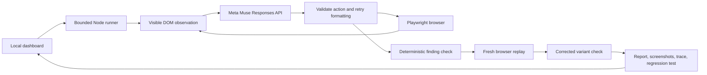

# Architecture

`dashboard-server.js` binds to loopback and launches one allowlisted runner at a time. It serves only allowlisted artifacts from the runs directory. API credentials remain in the backend environment; the UI receives only a configured flag. Mutating endpoints require a per-process token. This is not a hosted multi-user security design.

`hunt.js` orchestrates exploration. `meta.js` calls the Meta API. `actions.js` parses and validates outputs with at most three attempts per decision. `browser.js` observes the shop, limits actions, and checks the cart contract. The current checker uses visible quantity, unit price and coupon status, so it is not a comprehensive independent oracle for every possible shop defect.

`coverage.js` is a separate scripted evaluator. Its expected values come from the scenario contract in `scenarios.js`, independently of the UI. Those definitions are never sent to the exploration model. Each scenario uses a fresh browser context and checks every action.

`report.js` generates human-readable reports. Only confirmed hunt findings export regression tests. Screenshots and trace files are browser evidence; screenshots are not model inputs. Errors and step-limit outcomes remain distinct from confirmed findings.
