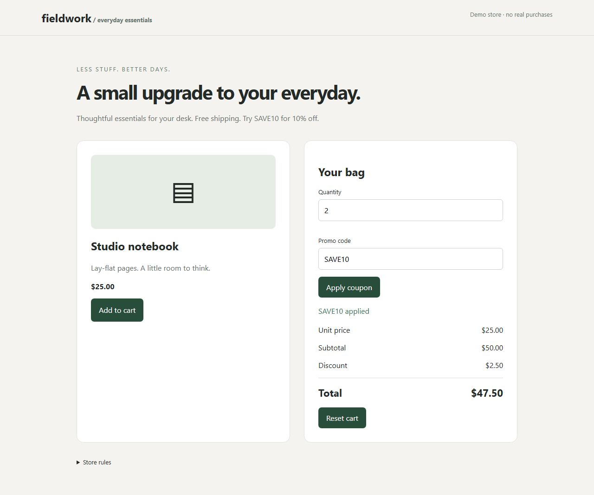

# Recorded live Meta example

Source run: `2026-11-03T18-54-22-665Z-meta` on `/shop`, using `muse-spark-1.3`.

These are selected artifacts from an actual live API run, not a scripted fixture. `evidence.json` contains the actions, arithmetic check, fresh replay and corrected replay. Screenshots show the controlled demo shop. Raw traces and complete local runs are excluded from the public repository.

The discount was $2.50 rather than $5.00 after quantity increased to two. Actual total was $47.50 rather than $45.00.




To execute the exported test with the standard project configuration, copy `regression.spec.js` into `runs/example/regression.spec.js`, start the shop with `npm.cmd start`, and run:

```powershell
npm.cmd run replay -- "runs/example/regression.spec.js"
$env:SHOP_PATH = '/fixed'
npm.cmd run replay -- "runs/example/regression.spec.js"
Remove-Item Env:SHOP_PATH
```

The first should fail; the second should pass. This is one selected successful demonstration, not a measured success rate. See `docs/evaluation.json` for the saved live-run outcomes available when packaged.
